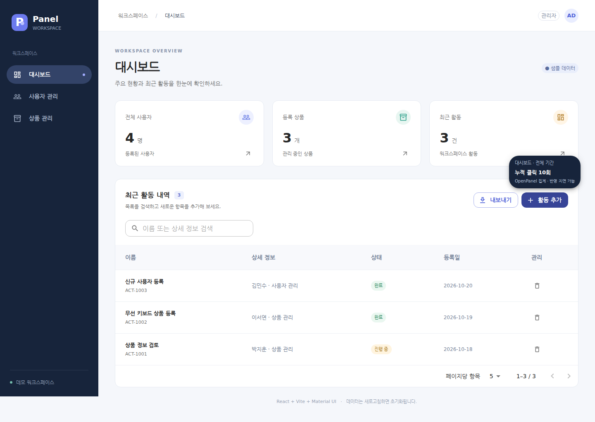
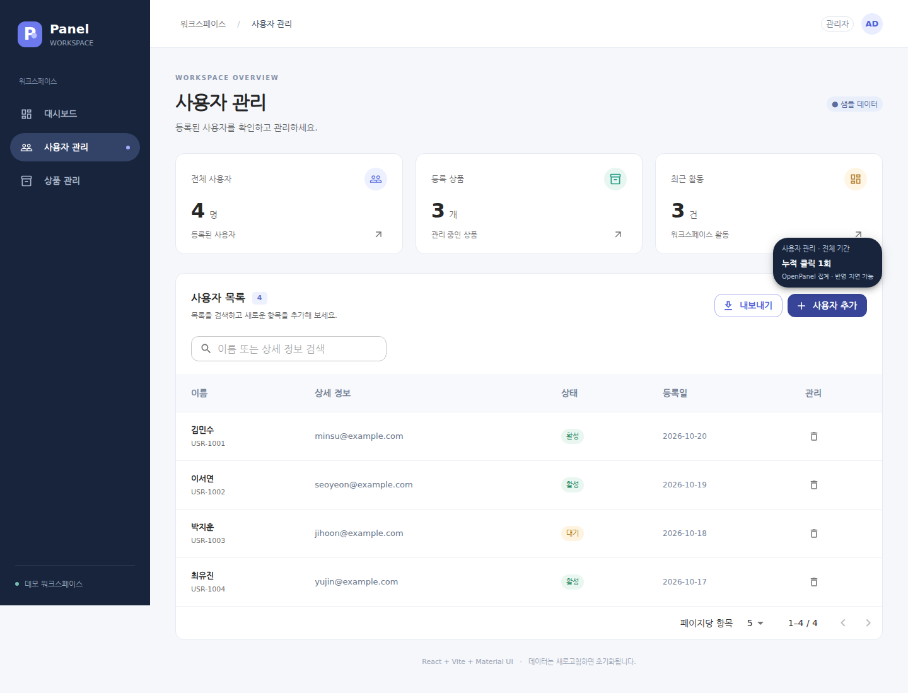

# 관리 패널

React + Vite + MUI로 만든 간단한 관리 화면입니다.

```bash
npm install
npm run dev
```

터미널에 표시되는 로컬 주소로 접속하세요.

- 왼쪽 메뉴: 대시보드, 사용자 관리, 상품 관리
- 메뉴별 테이블, 검색, 추가·삭제, 페이지 이동, CSV 내보내기
- 모바일 사이드 메뉴
- 백엔드 없이 샘플 데이터를 사용하며, 새로고침하면 변경 사항이 초기화됩니다.

프로덕션 빌드: `npm run build`
빌드 미리보기: `npm run preview`

## 실제 동작 화면

`http://localhost:5173`에서 실행 중인 화면을 캡처했습니다. 버튼에 마우스를 올리면 OpenPanel에 저장된 전체 기간의 클릭 횟수가 표시됩니다. 아래 횟수는 2026-10-20 캡처 시점의 값이며 사용에 따라 달라집니다.

**대시보드 — 활동 추가 버튼의 누적 클릭 10회**



**사용자 관리 — 사용자 추가 버튼의 누적 클릭 1회**



두 버튼은 동일한 `open_add_dialog` 이벤트 ID를 사용하지만 메뉴별로 별도 집계됩니다. 자세한 기준은 [버튼 위에서 누적 클릭 횟수 보기](#버튼-위에서-누적-클릭-횟수-보기)를 참고하세요.

## OpenPanel 통계 (Docker)

OpenPanel Analytics **공개 2.x 이미지**를 사용합니다. 구성은 `infra/openpanel/compose.yaml`에 있습니다. 웹 호스팅 관리 도구인 동명의 OpenPanel과는 다른 제품입니다.

### 실행

Docker Engine과 Docker Compose를 사용할 수 있는 터미널에서 실행합니다. 최초 이미지 다운로드와 데이터베이스 마이그레이션에는 수 분이 걸릴 수 있습니다. 공식 권장 메모리는 4GB 이상입니다.

```bash
npm run openpanel:up
```

이 명령은 다음 작업을 수행합니다.

1. PostgreSQL 비밀번호, 쿠키·암호화 키, 관리자 비밀번호, 프로젝트·Client ID를 생성합니다.
2. 비공개 서버 설정 `infra/openpanel/.env`와 공개 Client ID를 담은 `.env.local`을 생성합니다.
3. Caddy, PostgreSQL, Redis, ClickHouse, OpenPanel API·Dashboard·Worker 이미지를 실행하고 서비스 상태를 기다립니다.
4. OpenPanel 자체 회원가입 API로 관리자를 등록한 뒤 Test Panel 조직·프로젝트·브라우저 쓰기 전용 Client를 연결합니다.

기존 환경 파일과 데이터 볼륨은 재사용합니다. 첫 사용자를 만든 후 추가 회원가입은 비활성화됩니다. 관리자 등록에 성공한 뒤 프로젝트 연결만 실패한 경우 `npm run openpanel:bootstrap`으로 재시도할 수 있습니다. 기존 사용자가 있는 인스턴스라면 `infra/openpanel/.env`의 `OP_ADMIN_EMAIL`을 해당 계정으로 지정하세요. 이 경우 기존 계정 비밀번호는 변경하지 않습니다.

OpenPanel 접속: **http://localhost:3001**

로그인 정보는 **`infra/openpanel/.env`의 `OP_ADMIN_EMAIL`, `OP_ADMIN_PASSWORD`**에 있습니다. 환경 파일은 Git에서 제외됩니다. 기본 이메일은 `admin@example.com`이고 비밀번호는 무작위 생성됩니다. 이메일 발송 서비스는 사용하지 않습니다.

앱에서 새 환경변수를 읽도록 실행 중인 Vite를 종료하고 다시 시작하세요.

```bash
npm run dev
```

OpenPanel은 기본적으로 로컬 컴퓨터에서만 접근할 수 있도록 `127.0.0.1:3001`에 바인딩합니다. 데이터베이스와 Worker 포트는 호스트에 공개하지 않습니다. 다른 컴퓨터에서 앱을 접속한다면 `.env.local`의 API URL을 브라우저에서 접근 가능한 주소로 바꾸고, 프록시 포트 바인딩 및 OpenPanel 프로젝트의 허용 Origin도 함께 설정해야 합니다.

### 수집 이벤트

| 이벤트 | 집계 기준 | 주요 속성 |
| --- | --- | --- |
| `screen_view` | 최초 화면 및 실제 메뉴 전환마다 1회 | `menu`, `__path` |
| `menu_view` | 최초 화면 및 실제 메뉴 전환마다 1회 | `menu` |
| `button_click` | 화면의 활성화된 버튼 클릭마다 1회 | `menu`, `button` |
| `table_view` | 화면 진입, 검색, 페이지·페이지 크기 변경, 추가·삭제 후 목록 표시 | `menu`, `table`, `reason`, `page`, `page_size`, `total_rows`, `visible_rows`, `has_search` |

메뉴 ID는 `dashboard`, `users`, `products`입니다. `screen_view`의 경로는 `/dashboard`, `/users`, `/products`로 분리하므로 OpenPanel 기본 Overview의 페이지별 통계에서도 화면 방문 수를 볼 수 있습니다. `screen_view`와 `menu_view`는 같은 방문의 서로 다른 이벤트이므로 둘을 합산하지 마세요.

버튼 ID:

- 메뉴: `menu_dashboard`, `menu_users`, `menu_products`
- 통계 카드 이동: `navigate_dashboard`, `navigate_users`, `navigate_products`
- 테이블: `export_csv`, `open_add_dialog`, `delete_row`, `previous_page`, `next_page`, `page_size_select`
- 추가 창: `submit_add`, `cancel_add`, `close_add_dialog`
- 기타: `open_sidebar`, `dismiss_notice`

`button_click.menu`는 버튼을 누른 **출발 화면**입니다. 이미 선택된 메뉴를 다시 누르면 버튼 클릭은 집계하지만 방문 횟수는 늘리지 않습니다. React StrictMode의 중복 effect와 단순 재렌더링은 방문·테이블 조회 횟수를 늘리지 않습니다. 검색은 입력이 400ms 동안 멈춘 뒤 집계합니다.

이 앱은 서버에서 목록을 조회하지 않으므로 `table_view`는 **목록 표시 횟수**입니다. 서버 API 요청 횟수가 아닙니다. `reason=menu_enter`로 필터하면 화면 진입 시 조회만, `search`·`pagination`·`page_size`·`data_change`로 필터하면 해당 동작으로 발생한 조회만 볼 수 있습니다.

이름, 이메일, 검색어, 행 ID, CSV 내용은 이벤트에 넣지 않습니다. 검색어는 중복 조회 구분을 위해 브라우저 메모리에서만 비교합니다. 이벤트 전송 오류는 화면 동작을 막지 않으며, 실패한 이벤트는 재전송하지 않습니다. 따라서 서버가 중지되거나 브라우저가 전송을 차단하면 해당 이벤트는 통계에 포함되지 않습니다.

### OpenPanel에서 통계 보기

Test Panel 프로젝트에서 메뉴와 버튼을 사용한 뒤 Realtime/Events에서 `menu_view`, `button_click`, `table_view`가 들어오는지 확인하세요. 일반 통계는 Worker 처리 이후 반영됩니다.

다음 보고서를 Dashboard에서 생성하면 필요한 횟수를 비교할 수 있습니다. 집계는 **Total events / Count**를 선택합니다. Unique visitors는 클릭 횟수와 다릅니다. 사용자 지정 보고서는 자동 생성하지 않습니다.

| 보고서 | 이벤트 | Breakdown (그룹 기준) |
| --- | --- | --- |
| 메뉴별 접속 횟수 | `menu_view` | `menu` |
| 화면별 버튼 클릭 횟수 | `button_click` | `menu`, `button` |
| 화면별 테이블 조회 횟수 | `table_view` | `menu`, `reason` |

### 버튼 위에서 누적 클릭 횟수 보기

앱(`http://localhost:5173`)의 버튼에 마우스를 올리거나 키보드로 포커스를 이동하면 `누적 클릭 N회` 팝업이 표시됩니다. 메뉴, 통계 카드 이동, 내보내기, 추가·삭제, 페이지 이동, 다이얼로그 버튼에 적용됩니다. Escape 또는 마우스를 다른 곳으로 이동하면 닫힙니다.

- 현재 OpenPanel 프로젝트에 보관된 전체 기간의 `button_click` 이벤트를 `menu` + `button`별로 집계합니다. 같은 버튼이라도 출발 화면이 다르면 별도로 집계합니다. 행별 삭제 버튼은 해당 메뉴의 삭제 클릭 합계를 공유합니다.
- 이벤트가 없으면 `0회`, 서버 조회가 실패하면 `통계 조회 불가`로 표시합니다. 호버 자체는 클릭으로 집계되지 않습니다.
- 서버 캐시와 팝업 갱신 주기는 5초입니다. 이벤트 수집·Worker 처리 시간이 더해지므로 방금 클릭한 횟수는 늦게 반영될 수 있습니다.
- Vite 서버의 `/api/button-click-counts`가 Docker Compose를 통해 OpenPanel ClickHouse를 읽기 전용으로 조회합니다. Vite를 실행하는 사용자에게 Docker 접근 권한이 있어야 하고 OpenPanel이 실행 중이어야 합니다. 관리자 로그인이나 비밀번호를 브라우저에 전달하지 않습니다.
- `npm run dev`와 `npm run preview`에서 사용할 수 있습니다. `dist/`만 별도 정적 호스팅에 배포하면 통계 API가 없으므로, 별도 서버 연결이 필요합니다.

### 관리와 확인

```bash
npm run openpanel:status       # 컨테이너 상태
npm run openpanel:logs         # 로그
npm run openpanel:down         # 중지 (데이터 볼륨 유지)
npm run openpanel:up           # 다시 실행
npm run openpanel:setup        # Docker 없이 환경 파일 준비
npm run openpanel:config       # Compose 설정 문법 검증
npm test                      # 이벤트 집계·전송·장애 처리 테스트
npm run build                 # 앱 빌드
```

데이터는 Docker named volume에 보관합니다. `down -v`로 삭제하지 마세요. 개발 서버의 기본 Origin은 `http://localhost:5173`, `http://127.0.0.1:5173`, 빌드 미리보기 Origin은 동일 호스트의 `4173` 포트입니다. 다른 포트를 사용하면 OpenPanel 프로젝트 설정의 CORS 목록에 추가해야 합니다.

설정 근거: [공식 Docker Compose 안내](https://openpanel.dev/docs/self-hosting/v2/deploy-docker-compose), [공식 2.x Compose 템플릿](https://github.com/Openpanel-dev/openpanel/blob/self-hosting/self-hosting/docker-compose.template.yml), [Track API](https://openpanel.dev/docs/api/track).
